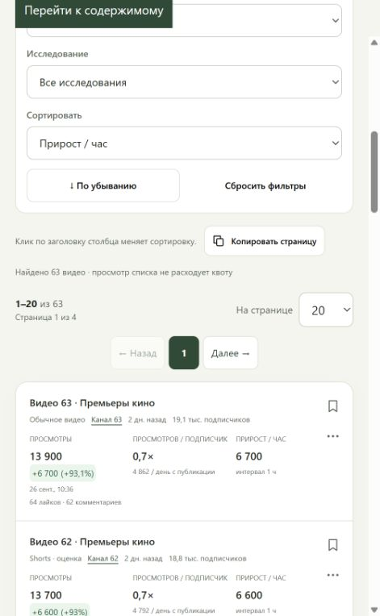

# Topic Radar

### Находите видео, которые растут у небольших YouTube-каналов.

[](https://github.com/Vangardo/content_radar/actions/workflows/ci.yml)
[](https://github.com/Vangardo/content_radar/releases)
[](LICENSE)
[](https://github.com/Vangardo/content_radar/pkgs/container/content_radar)

[English](README.en.md) · [Руководство](PRODUCT_GUIDE.md) · [Установка на сервер](README_SERVER.md) · [Релизы](https://github.com/Vangardo/content_radar/releases)

Topic Radar — самостоятельный сервис для исследования тем и мониторинга роста видео.
Введите запросы, выберите язык и формат: сервис найдёт публикации, сохранит метаданные
и покажет, что набирает просмотры у каналов **до 10 000 подписчиков**. Порог можно изменить.
Русский интерфейс; поиск с предпочтением русского или английского.

**Без LLM, платной подписки и внешней аналитической платформы.** Нужен собственный
YouTube Data API key. База и настройки остаются у вас.



> Первая публичная версия — MVP для одного владельца. Сигналы помогают выбрать видео
> для изучения; они не предсказывают число просмотров вашего будущего ролика.

## Что внутри

| Возможность | Как помогает |
| --- | --- |
| Небольшие каналы | Рейтинг учитывает размер канала и измеренный прирост. |
| Два интервала | Поиск раз в 4–24 часа; замеры лидеров раз в 30–120 минут без повторного поиска. |
| Shorts и обычные видео | Раздельные исследования и фильтры. Shorts помечаются как оценка. |
| Метаданные | Название, описание, теги, хэштеги, реакции и исходный публичный JSON. |
| Видео и каналы | Каталоги, поиск, сортировка, страницы, графики и прирост в час. |
| Избранное | Заметки, обновление одной карточки или всех избранных объектов. |
| История и экспорт | Снимки, CSV / JSON / Markdown, копирование, корзина исследований. |
| Сервер и интеграции | Docker, вход владельца, шифрование ключей, HTTP API с отзываемыми токенами. |

## Начать на Windows

Нужны Git и [uv](https://docs.astral.sh/uv/getting-started/installation/).

```powershell
git clone https://github.com/Vangardo/content_radar.git
cd content_radar
.\setup.ps1
.\.venv\Scripts\python.exe -X utf8 -m app.local_setup
.\start.ps1
```

Откройте **http://127.0.0.1:8877**. Команда настройки один раз покажет случайный пароль
владельца `admin`; сохраните его. В **Настройках** добавьте YouTube API key,
создайте исследование и запустите сканирование. Для повторных запусков достаточно `start.ps1`.

[Подробная установка](README_LOCAL.md) · [Docker и HTTPS](README_SERVER.md)

## Попробовать без API-ключа

```powershell
.\.venv\Scripts\python.exe -X utf8 -m tests.preview_server --catalog
```

Откройте **http://127.0.0.1:8879**, войдите как `fixture-owner` с паролем
`fixture-password-123`. Это демонстрация: временная база и синтетические данные,
запросы к YouTube не выполняются, реальные ключи вводить не нужно.
После остановки база удаляется. [Сценарий демонстрации](docs/DEMO.md).

## Как работает рост

1. Поиск находит до 50 / 100 / 200 / 500 видео на запрос. Совпавшие ID объединяются.
2. Первый ответ сохраняет исходный счётчик. Просмотры за день — среднее за жизнь видео.
3. Повторный ответ минимум через 30 минут даёт **измеренный прирост в час**.
4. Монитор чаще обновляет сильные небольшие каналы и новых кандидатов. Широкий цикл
   пересматривает весь список, чтобы вернуть поздно растущие видео.

Темы объединяются простыми правилами и словарём. Формулы и ограничения — в
[руководстве](PRODUCT_GUIDE.md).

По документации YouTube, по умолчанию проекту доступны 100 вызовов `search.list` и
10 000 единиц прочих методов в сутки; следующая страница — отдельный вызов.
Актуальные лимиты проверяйте в Google Cloud.
[Источник: YouTube Quota Calculator](https://developers.google.com/youtube/v3/determine_quota_cost).

## Данные и границы

- Это выборка результатов YouTube, а не обзор всей платформы. Язык — предпочтение поиска.
- API не возвращает надёжный флаг `isShort`: сервис показывает оценку и неопределённые случаи.
- Публичные API-данные хранятся **28 дней**. Заметки и ID избранного — отдельно.
- Тексты комментариев и приватная аналитика владельцев каналов не запрашиваются.
- Один процесс, один владелец, одна SQLite. Многопользовательский SaaS и публикация видео
  не входят в эту версию.
- При перезапуске незавершённые операции помечаются прерванными; результаты сохраняются.
  Продолжение с контрольной точки пока не реализовано.
- Общих ключей и паролей в поставке нет. Для сервера нужны собственные секреты и HTTPS.

## Для разработчиков

Python 3.11 · FastAPI · SQLite · обычный JavaScript. Готовый пакет —
[контейнер GHCR](https://github.com/Vangardo/content_radar/pkgs/container/content_radar).
Python-запуск выполняется из исходников; публикации в PyPI нет.

[Архитектура](docs/ARCHITECTURE.md) · [Участие и тесты](CONTRIBUTING.md) ·
[Безопасность](SECURITY.md) · [Изменения](CHANGELOG.md) · [План развития](docs/ROADMAP.md)

## Лицензия и происхождение

[MIT](LICENSE). Разработан на основе
[sentien-labs/youtube-niche](https://github.com/sentien-labs/youtube-niche):
транспорт YouTube, кэш и часть обработки результатов. Исходный CLI сохранён
для совместимости; его LLM-модули не вызываются веб-сервисом и не входят в зависимости Radar.
[Исходный снимок и изменения](UPSTREAM.md).

Проект не связан с YouTube или Google и не поддерживается ими.
