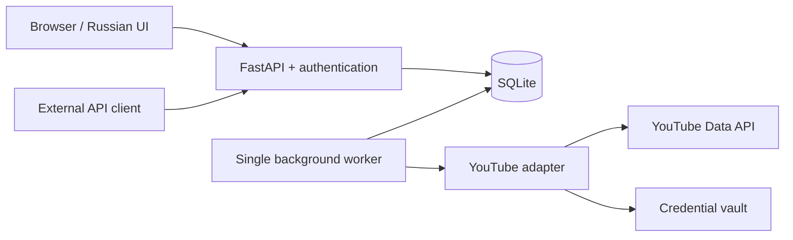

# Architecture

| Area | Location | Responsibility |
| --- | --- | --- |
| HTTP/access | app/main.py, product.py, entity_api.py, access.py | UI/API, CSRF, ownership, tokens |
| Data | app/storage.py, migrations/ | Observations, research, runs, history, retention |
| Execution | app/worker.py, entity_worker.py, monitoring.py | Queue, schedules, discovery, refresh |
| YouTube | app/engine_adapter.py, youtube_niche/youtube_client.py | Batches, cache, quota accounting |
| Signals | app/signals.py, metrics.py, grouping.py | Growth and conservative grouping |
| Metadata | app/video_metadata.py, channel_metadata.py | Public resource normalization |
| Credentials | app/credentials.py, secrets.py, server_security.py | OS vault/encrypted files, login |
| UI | app/static/, app/templates/ | HTML, vanilla JavaScript and CSS |

The worker polls persisted jobs and runs them sequentially. A process lock prevents two
app instances sharing a database. No Redis, message broker or LLM.

Response timestamps are preserved; reading cached responses does not create fresh
measurements. The first observation is not measured growth. Migrations apply sequentially
at startup. API-derived data expires after 28 days; notes and saved IDs are separate.

A database rollback requires a matching backup: changing images does not undo migrations.
Upstream CLI features outside Radar are retained for provenance and regression coverage.
See [UPSTREAM.md](../UPSTREAM.md) for the exact source snapshot.
